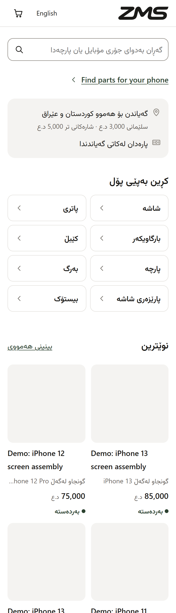
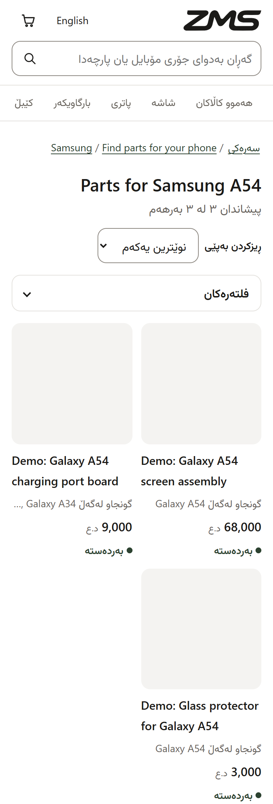
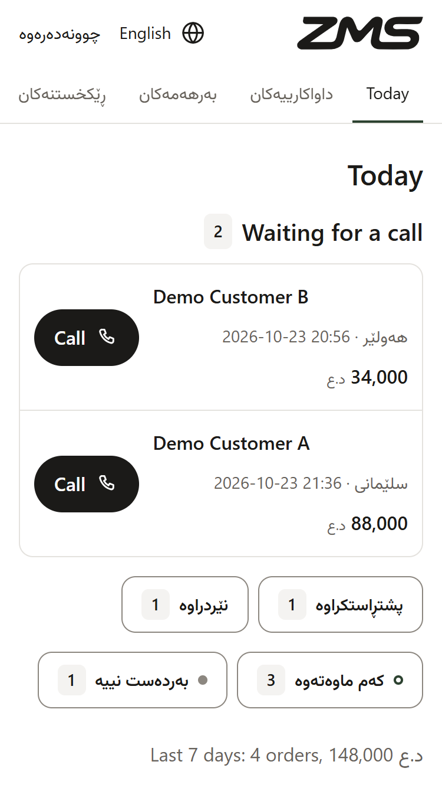

<!--
  Showcase README for the public repo arman-mahabad/zandms.store.
  The code lives in a private repo. This repo holds only this page and its pictures.
-->

<a href="https://byarman.site">Made by Arman ↗</a>

# ZMS store

**An online shop for a phone-parts business, Kurdish first, with English beside it, and an admin the owner runs from a phone.**

**Live** at [zandms.store ↗](https://zandms.store) &nbsp;·&nbsp; Client work &nbsp;·&nbsp; The owner is adding the products now, so the pictures here use demo data. The code is private.

The Kurdish home page. Demo data: the products here are placeholders while the owner adds the real ones.

Customers here mostly shop on cheap phones and pay cash on delivery. So the shop sends almost no JavaScript, and a first visit to a Kurdish product page loads 140 KB in total. First commit on 7 October, live on its own domain on 16 October.

## The hard parts

### Stock that fake orders can't drain

Cash on delivery invites fake orders. If stock dropped the moment someone ordered, a few fake orders could empty the shop. So stock drops only when the owner confirms an order and comes back if it's cancelled, tracked line by line. The server also works out every price again in whole dinars and ignores what the browser sends.

### Kurdish that nobody made up

I don't trust a model's Sorani in front of customers, so no Kurdish in the shop comes from AI. Every Kurdish line comes from a glossary built from five real Kurdish sites, or the owner types it. Until then the line stays in English with a marker. A check fails the build if any Kurdish string isn't word for word in the glossary.

Right-to-left pages with English stand-ins flip punctuation around. Unicode isolates keep each full stop where it belongs.

### Fast under a strict security policy

No framework JavaScript, cached fonts and styles, and a content security policy strict enough that every inline script needs a hash.

## Finding the right part

A customer picks their phone model and sees the parts listed for it, with filters and sorting.

Parts for one phone model. Demo data.

## What the owner gets

An admin built for a phone: today's orders, stock and products, with a Telegram message for every new order. Hosting costs about nothing each month.

The owner's Today screen. The customers and orders are demo data, because the shop has no orders yet.

## In numbers

- **287** automated tests in 21 files.
- **140 KB** for a first visit to a Kurdish product page.
- **9 days** from first commit to live.

## My part

Built for a client, the shop's owner. I designed it and directed the build. The owner runs the shop and adds the products.

**Built with:** `Cloudflare Workers` `D1` `R2` `Hono` `TypeScript` `Vitest` `Telegram`

## Not done yet

- The owner is adding products. No orders yet.
- A native speaker still has to review the Kurdish, and some lines are still in English.
- The link to the shop's till system is written but not connected.

---

I can walk you through the code on a call: [arman@byarman.site](mailto:arman@byarman.site)

More of my work: [byarman.site](https://byarman.site) &nbsp;·&nbsp; [github.com/arman-mahabad](https://github.com/arman-mahabad)
